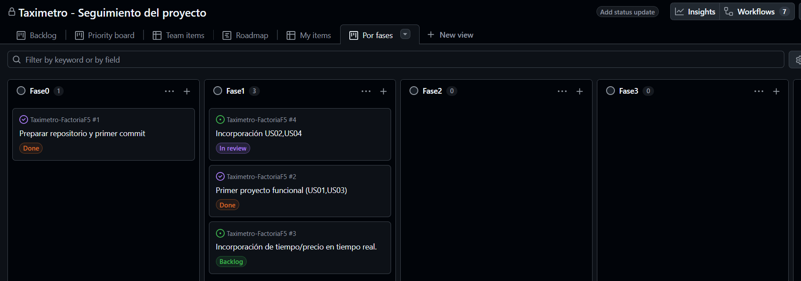

# Fase 1 — Memoria del MVP funcional

Esta memoria recoge qué incluye la fase 1, cómo funciona el taxímetro y qué comprobamos antes de la entrega.

**Estado de la implementación:** completada y revisada.

## Objetivo y alcance

Desarrollar una aplicación de terminal que calcule el importe de una carrera según el tiempo transcurrido en cada estado del taxi y permita realizar carreras consecutivas.

El programa de esta fase es [`taximeter.py`](../../taximeter.py).

## Ejecución

Desde la raíz del repositorio:

```bash
python taximeter.py
```

Los requisitos, la instalación y la guía de uso están en el [README principal](../../README.md).

## Cómo funciona el taxímetro

El menú principal funciona con un bucle `while` que espera comandos. El bucle solo se rompe al escribir `salir`. Al introducir `iniciar`, se llama a la función que gestiona la carrera y empieza a contar el tiempo. La carrera comienza en estado parado, se muestran sus instrucciones y el indicador de la terminal cambia a `carrera>`.

Dentro de la función hay otro `while` que espera los comandos de la carrera. Con `parado` y `movimiento` se selecciona la tarifa. Cada vez que cambia el estado, el programa suma el coste del tiempo transcurrido con la tarifa anterior y empieza a contar el siguiente tramo con la nueva.

Cuando se introduce `finalizar`, el programa suma el coste del último tramo y muestra la duración y el importe total. La función de la carrera termina y el programa vuelve al bucle del menú principal. Desde ahí se puede iniciar otra carrera o salir.

### Cómo se cumple cada historia de usuario

| Historia | Cómo se cumple |
| --- | --- |
| **US-01 · Iniciar una carrera** | El `while` del menú principal espera el comando `iniciar`. Al recibirlo, llama a la función de la carrera y se empieza a medir el tiempo. |
| **US-02 · Cambiar de estado** | El `while` de la carrera recibe `parado` o `movimiento`. Si cambia el estado, se suma el importe del tramo anterior y se aplica la nueva tarifa a partir de ese momento. |
| **US-03 · Finalizar y mostrar el importe** | El comando `finalizar` cierra el último tramo y muestra la duración total y el importe en euros con dos decimales. |
| **US-04 · Iniciar otra carrera** | Al terminar la función se vuelve al mismo bucle principal. Si se vuelve a escribir `iniciar`, comienza otra carrera con sus propios tiempos y un importe inicial de cero. |

## Funcionamiento del cálculo

1. Al iniciar una carrera, se guardan el instante inicial de la carrera y el del primer tramo.
2. Al cambiar de estado, se calcula el tiempo transcurrido en el tramo anterior.
3. Se multiplica esa duración por la tarifa que estaba activa y se suma el coste al acumulado.
4. Se inicia un nuevo tramo con el estado seleccionado.
5. Al finalizar la carrera, se añade el último tramo y se muestran la duración y el importe total.

Si se repite el estado actual, se mantiene el tramo sin reiniciar su referencia temporal. Los comandos incorrectos tampoco interrumpen la medición.

Cada nueva carrera comienza con sus propios tiempos y un importe acumulado de cero.

### Ejemplo de cálculo

| Tramo | Cálculo | Importe |
| --- | --- | --- |
| 10 segundos parado | 10 × 0.02 | 0.20 € |
| 20 segundos en movimiento | 20 × 0.05 | 1.00 € |
| 5 segundos parado | 5 × 0.02 | 0.10 € |
| **Total: 35 segundos** | | **1.30 €** |

## Evidencias de la entrega

Los archivos de esta fase se agrupan en `Entregables/Fase1/`.

### Vídeo de demostración

[Ver o descargar la demo de la fase 1](Taximetro_Fase1.mp4).

### Captura del tablero

La vista **Por fases** agrupa las tareas en una columna por fase. El campo **Status** indica el avance de cada tarea.



[Abrir la vista Por fases en GitHub Projects](https://github.com/users/gabrielq03/projects/1/views/6).

## Referencias de la entrega

- [Repositorio en GitHub](https://github.com/gabrielq03/Taximetro-FactoriaF5).
- [Tablero de seguimiento — vista Por fases](https://github.com/users/gabrielq03/projects/1/views/6).
- [README principal](../../README.md).
- [Código de la fase 1 (`taximeter.py`)](https://github.com/gabrielq03/Taximetro-FactoriaF5/blob/e2e2e847a743861ac40387dabe9fda7b2f068bad/taximeter.py).
- **Commit del código presentado:** [`e2e2e84`](https://github.com/gabrielq03/Taximetro-FactoriaF5/commit/e2e2e847a743861ac40387dabe9fda7b2f068bad).

## Límites de esta versión

La fase 1 permite calcular carreras desde la terminal. El importe se muestra al finalizar.

El historial persistente, los logs, la configuración externa de tarifas, los tests automatizados y otras interfaces quedan fuera de esta entrega.
